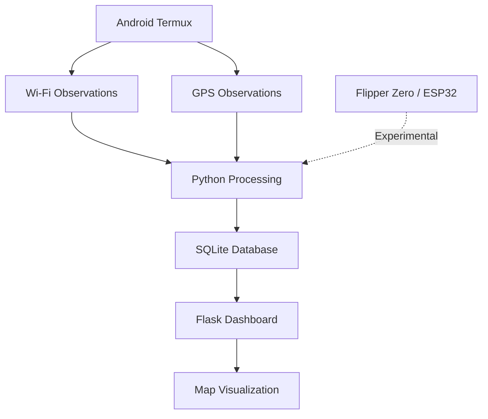

<!-- portfolio:start -->

# 📡 Sentinel Wardriver

### Python | Wi-Fi Discovery | GPS Mapping | Flask

A mobile wireless-network surveying project built
with Python and Android Termux.

Sentinel Wardriver combines Wi-Fi observations,
optional GPS information, and a Flask dashboard
for exploring wireless-network mapping.

## Overview

This project investigates mobile wireless discovery,
location-aware observations, and visualization of
collected survey information.

It also explores optional integrations with
Flipper Zero and ESP32 Marauder hardware.

## Technical Focus

- Wi-Fi network discovery
- GPS-assisted wireless surveying
- Android Termux development
- Python automation
- Flask dashboard visualization
- SQLite data storage
- Experimental hardware integration

## Architecture



## Technology Stack

| Technology | Purpose |
|---|---|
| Python | Scanning and processing |
| Flask | Web dashboard |
| SQLite | Local observation storage |
| Termux | Android runtime |
| GPS | Location observations |
| Leaflet | Interactive mapping |
| Flipper Zero | Experimental integration |

## Deployment Notes

Wireless scanning and GPS collection run on
supported local hardware, such as an Android
device using Termux.

A hosted Flask dashboard does not automatically
gain access to the phone's Wi-Fi or GPS sensors.

Remote data synchronization requires separate
implementation and appropriate authentication.

## Development Roadmap

- [ ] Improve wireless survey reporting
- [ ] Expand dashboard filtering
- [ ] Add authenticated remote access
- [ ] Develop secure data synchronization
- [ ] Improve Flipper Zero integration
- [ ] Expand GPS visualization
- [ ] Add automated tests

## Privacy and Responsible Use

Only survey networks and locations where you
have permission to perform testing.

Wi-Fi identifiers, GPS coordinates, and survey
databases may contain sensitive information.

Do not publish private observation data or
expose an unauthenticated dashboard online.


## Getting Started

Clone the repository:

```bash
git clone https://github.com/cabralisjota/sentinel-wardriver.git
cd sentinel-wardriver
```

Start the local Flask dashboard:

```bash
python wardriver_map.py
```

The dashboard requires an appropriate local
environment and any necessary dependencies.

## Developer

**GitHub:** [@cabralisjota](https://github.com/cabralisjota)

**Interests:** Cybersecurity, Python, network
security, security automation, and IoT.

---

<!-- portfolio:end -->

## Additional Project Documentation

# Sentinel Wardriver

https://sentinel-wardriver-2.onrender.com/

Android-based Wi-Fi wardriving and wireless
network visualization platform.

Built with Python, Flask, SQLite, Termux,
and experimental Flipper Zero integration.

## Features

- Wi-Fi access point discovery
- SSID and BSSID collection
- Signal strength monitoring
- GPS location tracking
- SQLite observation storage
- Interactive Leaflet map
- Wi-Fi observation history
- CSV data export
- Flipper Zero USB communication
- Mobile-friendly dashboard

## Technology

- Python
- Flask
- SQLite
- Android Termux
- Termux:API
- Leaflet.js
- Flipper Zero / ESP32 Marauder

## Installation

Install Termux and Termux:API.

In Termux:

    pkg install python termux-api
    pip install flask

Grant the required Android location
and Wi-Fi permissions.

## Running Sentinel

Start the dashboard:

    python wardriver_map.py

Open:

    https://sentinel-wardriver-2.onrender.com/

In another Termux session, start scanning:

    python continuous_scan.py

## Flipper Zero Integration

USB communication with the Flipper Zero
CLI has been demonstrated.

Marauder scan-log importing is experimental
and not yet fully integrated.

## Privacy and Security

Only scan networks you are authorized
to assess.

GPS databases, collected Wi-Fi observations,
logs, and local configuration data should
not be committed to public repositories.

## Status

Version: 0.1.0-beta

Development is ongoing.
